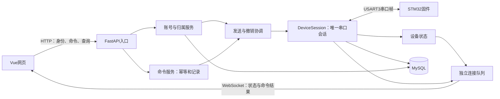

# Pet-Dog 项目目标架构与团队分工

> 版本：3.0简明版；更新：2026-11-10。
> 范围和排期以[统一主计划](项目统一实施与交付计划_V3.0.md)为准，验收见[追踪表](项目统一计划V3_需求追踪与验收.md)。
> 本文解释目标架构，不代表功能已实现。接口契约正在等待[T01同步](../contracts/T01_契约同步清单.md)，不能把旧契约与本页混着实现。

## 1. 小组这次要交付什么

网页安全控制一台真实桌宠：用户登录、认领自己的设备，发动作，看到受理与完成结果；设备上报状态，断线和重启有明确恢复方式。首版交付七个基础动作码和七张预设表情，以及最小账号归属安全。

天气、音乐、语音、场景、承诺提醒、多设备和完整管理员页面属于扩展，不同时压进核心排期。完成核心后按V3门槛决定是否加入。

## 2. 三端如何连接

前端不直接连接硬件，固件不调用后端代码。后端是单进程单worker部署，一条实际链路只有一个DeviceSession。没有板子时用进程内模拟器验证软件链路，真机能力必须另做硬件验收。

## 3. 每个人做什么

| 角色 | 主要职责 | 主要交付 |
|---|---|---|
| 后端A | 帧解析、串口会话、命令、发送撤销协调、WS | SIM闭环、命令状态与故障恢复测试 |
| 后端B | 账号、设备归属、数据库迁移、CLI恢复、业务接口 | 两账号隔离、认领解绑、备份恢复 |
| 前端 | 页面、命令状态、身份缓存隔离、WS与HTTP对账 | 状态不误报、切账号不串数据、重连恢复 |
| 嵌入A | 固件解析、动作tick、表情、遥测、看门狗 | 七基础码/七表情、正确回执、板上测时 |
| 嵌入B | 采购、接线、供电、机械校准、PCB、装配 | 安全可运行实物、接线图、供电测试 |
| 组长 | 确认投入与实物日期、契约评审、里程碑验收 | 每周证据和问题台账，扩展准入决策 |

任务对应V3中的T01～T12；不在本页另建一套排期。

## 4. 一条动作命令的完整过程

1. 前端先生成UUID作为Idempotency-Key和cmd_id，再发送请求。
2. 后端检查当前账号是否拥有设备。同键同内容返回原记录，不再次发动作。
3. 命令先持久化，再进入唯一发送路径；发送前再次核对账号和设备归属版本。
4. 0x81表示设备受理；0x02表示动作完成；0x05表示设备明确拒绝。
5. 超时记unknown，表示不知道执行结果；不自动重试，前端不自行用3秒判失败。
6. 后端把状态变化存库后推command事件。前端按cmd_id和revision合并，HTTP晚到也不能覆盖更晚状态。
7. 连接断开后查询原命令结果，不重发动作。

首版同一设备一次只执行一个运动命令，忙时明确拒绝新运动，不积压也不抢占。unknown且可能已写出时进入恢复门禁，不直接允许下一条运动。superseded仅保留给后续抢占功能。

状态为pending、accepted、done、rejected、unknown、superseded；传输结果另列：尚未写、完整写入、确定未写、部分写/结果不明。串口write成功只证明本机驱动接受字节，不代表设备完成。

## 5. 状态、权限与恢复

有效设备上行帧刷新online；9秒无有效上行判离线。后端每3秒发心跳，固件9秒无下行心跳停止新的运动步骤并保持姿态。这两套判断分别验收。

JWT绑定用户token_version；设备使用binding_epoch区分不同主人。数据库查询和实时缓存都要隔离归属。改密使旧身份失效；解绑使旧设备权限失效；已发出物理动作无法被数据库撤销。

解绑后设备进入交接门禁。管理员停止后端、完成设备复位和链路清理、核对登记映射后通过complete-handover恢复可认领状态；启动后读取新快照才允许控制。没有硬件身份协议，不能声称自动证明所有权。

seq为1字节。首版同物理会话不复用序号，耗尽或重启需净化会话；未匹配回执保留诊断证据。现有协议不能证明无限迟到帧安全，具体限制见主计划。

WS使用一次性ticket，每连接队列128；遥测可合并，关键事件不能被挤掉。慢连接被关闭后通过HTTP补齐状态，不影响串口。前端切账号先更换会话代次，旧响应、旧401和旧WS消息不能污染新用户。

## 6. 目录责任

沿用现有目录，按需要新增：

| 位置 | 用途 |
|---|---|
| backend/app/routers/ | HTTP/WS入口，不直接操作串口 |
| backend/app/services/ownership.py、claim.py | 归属和认领事务 |
| backend/app/services/command_service.py | 幂等、持久化和命令查询 |
| backend/app/link/device_session.py、send_gate.py | 唯一会话、发送与撤销协调 |
| backend/app/link/frame.py、serial_link.py、simulator.py | 帧处理、真串口和模拟 |
| backend/app/link/hub.py | WS分发；不兼任第二个设备会话 |
| backend/app/services/device_state.py | 当前快照与online |
| backend/app/models.py、backend/alembic/ | 数据模型和迁移 |
| frontend/src/ | 现有api/store/view/utils增量修改 |
| firmware/、hardware/ | 保留原工程结构，分别管理固件和硬件 |
| docs/contracts/ | T01之后统一发布的接口依据 |

## 7. 交付证据与汇报

每个成果标注SIM或HW；模拟器通过不能抵扣真机门禁。七基础动作分别测时、校准行程与供电；数据库迁移在隔离库先完成中断重跑和恢复演练。

原始遥测保留7天；日聚合365天随曲线扩展加入，不列首版必做。命令日志是恢复依据，旧归属数据不能交给新主人。

汇报重点：单一设备出口、可区分的命令结果、账号归属隔离、异常恢复和真实验收记录。日期、工时和待验证项直接引用V3主计划，不把尚未完成的能力写成现有成果。
