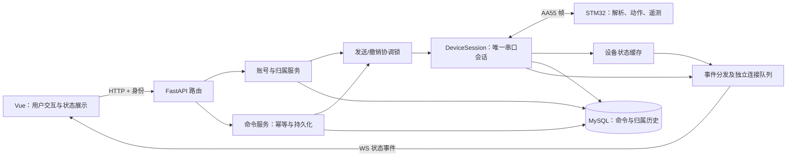

# Pet-Dog 统一实施与交付计划 V3.0

> 编制日期：2026-11-10。交付目标：2026-12-27。  
> 用户已确定范围：**核心闭环优先，扩展按进度纳入。**  
> 本文是本次整合后的执行基线；不是“全部实现已验证”的声明。仅新增计划，不修改现有代码、契约、数据库或设备。  
> 阅读顺序：组长看第 1、2、10、13 节；开发者再读第 3—9、11 节；验收使用配套《需求追踪与验收表》。

## 1. 最终交付是什么

交付一台能通过网页安全控制的桌面宠物，以及可重复部署的软件：

1. 初始化管理员，注册普通账号；用户只能查看和控制归属自己的设备。
2. 认领设备后，网页发出动作，设备返回受理与完成，网页准确显示结果。
3. 固件实现七个基础动作码、七张预设表情、动作表情联动和状态上报。
4. 断线、超时、刷新、后端重启、改密、解绑都不会自动重复执行旧动作或泄漏前一用户的数据。
5. 有固件工程、硬件接线与供电说明、迁移和备份恢复流程、真实测试记录，另一名组员可以部署演示。

七个基础动作码是 0x30 蹲下、0x31 站立、0x32 趴下、0x33 前进、0x34 后退、0x35 左转、0x36 右转。它们对应原表 F-1-01～F-1-05 的五项功能，**不是五个动作码**。21 个协议码全部保留，但未实现的码不得伪装成功或显示为已支持。

天气、音乐、语音、承诺提醒、跳跃、完整管理员界面、多设备并发、OTA 不属于本期必交付。扩展功能必须在核心验收通过后逐项放行，不能因为原文档某处写着 P0 就自动挤占本期工时。

## 2. 整合依据与原文档关系

### 2.1 本次核查范围及证据等级

已读取 docs/plan 中原项目计划书、总分工、三条线计划、功能汇总表、答辩方案、市场调研、前端开工方案和架构总览；对照当前六份契约以及后端模型、认证、设备路由、前端目录和依赖清单。

本次未连接数据库核实实际行数，未运行应用测试，未连接真板；因此 v10 中“现有两行 user”、模块型号、板子到货日期、动作实测值不能当成本次实测结论。当前工作区有 frontend/.env.development 的既有修改，不纳入本次计划产物。

补齐稿中的“十三轮可以冻结”是历史评审结论，不能代替本轮范围、并发和实测验证。

### 2.2 发现的冲突与本版裁决

| 冲突 | 来源 | 本版裁决 |
|---|---|---|
| 核心 15 项 vs 46 项全部推进 | 项目计划书与功能汇总表/分线 V2 | 核心 15 项保留，最小权限安全加入同一交付；其余逐项记录，不静默删除 |
| 新增承诺库但排除多用户 | 市场调研与 v10 | 承诺提醒列为候选扩展；账号隔离先保证；市场假设不当作用户已验证需求 |
| P0 先做账号管理，P1 才做设备 | v10 §13 | 废除该阶段划分；权限与设备通信并行，撤销保护必须与发送通道同批上线 |
| 15–22 天 vs 分项 10 天 | v10 §13 | 2+2.5+1.5+1+1+2=10，全职工日与原计划每周 14 小时不可混用；采用角色工时预算 |
| ack 只推受理、完成不推、四态/六态并存 | 当前 events/http-api 与 frame | 统一六态生命周期；新增 command 状态事件；ack 仅保留兼容通知，不决定最终结果 |
| 后端生成 cmd_id，网络重试无法查原单 | 当前 OpenAPI | 前端生成 Idempotency-Key UUID；后端持久化为 cmd_id；同键同体返回原单 |
| 要求 WS 一定晚于 HTTP | 当前 OpenAPI | 删除跨通道顺序保证；前端发送前登记 cmd_id，用 revision 防止响应回退 |
| LED 收 0x81 完成与通用 ACK 语义冲突 | action-timing 与 frame | 核心不开放 LED；扩展时必须定义“状态写入成功之后回 ACK”的专用语义并测试 |
| 1600ms 被称作实测 | action-timing | 它是打招呼步骤延时求和，不是板上最坏时长；不是基础七动作验收值 |
| 0x0B 上报时机被列成未定义 | 先前架构总览 | 嵌入式 V2 §7.7 已写状态变化时上报；实现仍需真机验证 |
| 短帧前缀兼容被当作任意布局兼容 | frame 与项目计划书附录 | 只有字段偏移不变的前缀才兼容；不同布局必须选择版本配置，禁止猜测 |
| 所有旧账号自动失效、假定恰有两行 | v10 迁移 | 先清点和备份；明确演示账号失效，真实用户保留或经确认迁移，禁止按条数写脚本 |
| 停机迁移却为滚动发布无限推迟 NOT NULL | v10 §10 | 首版停机迁移；归档不明旧行后，活跃表可在同一发布前完成约束收口 |
| 单个长连接命名锁等于全过程单实例 | v10 | 数据库锁连接丢失必须停止发送并退出；再加串口所在主机的进程锁，防旧实例继续写 |
| 每 20ms 一帧，50 条总耗时≤2s含完成 | 旧验收 | 1.44875s 仅是 50 个9字节下行帧的理论传输下限；不包含动作执行、往返回执和调度 |
| 用户解绑后立即让新主人接收数据 | v10 | 归属撤销立即生效；设备交接检查通过后才能再次认领和接受新遥测 |
| “阻塞动作”易误解成阻塞主循环 | action-timing | 改称占用运动资源；固件必须 tick 非阻塞运行 |
| 12/07 被写成周日 | V2 日历 | 2026-12-07 是周一，W6 为 12/07—12/13 |

### 2.3 文档如何合并

本文决定范围、责任、阶段与验收；六份 contracts 决定字节和字段。**第一个任务就是按上表修订契约并同时发布版本**，不能以本文悄悄覆盖旧契约，也不能让“契约永远正确”阻止纠错。

旧 DOCX 保留作历史资料，统一在首页加入“执行差异见 V3.0”说明，并修正可直接复制执行的错误示例。架构总览保留解释用途，更新与本版冲突的目录、事件和状态。不要维护另一份重复的全量协议表。

本版批准的分期优先于旧 P0 标签；未纳入本期的功能保留原编号，进入扩展清单。工作量增加、字段破坏性变更和必交付减少都必须在评审记录中明确写出。

## 3. 架构与实现位置

首版部署：一台 Windows 主机、一个 FastAPI worker、一条实际设备链路、一个 MySQL 写实例；允许多个账号，但一个账号最多一台设备、同一设备同时只有一个主人。多账号不等于多设备同时通信。

代码按现有目录增量建设，不先做大规模搬家：

| 文件/目录（仓库相对路径） | 所有者 | 职责 |
|---|---|---|
| backend/app/main.py、run.py | 后端 A | lifespan、任务关闭、单实例、部署启动 |
| backend/app/models.py、db.py、backend/alembic/ | 后端 B | 表结构、事务、迁移；暂不拆模型包 |
| backend/app/security.py、deps.py | 后端 B | 密码、JWT、账号状态/版本、统一授权 |
| backend/app/services/ownership.py | 后端 B | 唯一的绑定、解绑、注销入口 |
| backend/app/services/claim.py、app/cli.py | 后端 B | 配对码、本机初始化和恢复 |
| backend/app/services/command_service.py | 后端 A，B review | 幂等、授权上下文、落库及查询 |
| backend/app/link/frame.py、serial_link.py、simulator.py | 后端 A | 字节编解码、单读端、模拟故障 |
| backend/app/link/device_session.py、send_gate.py | 后端 A | seq、计时、发送、撤销协调 |
| backend/app/services/device_state.py | 后端 A | 快照、online、遥测来源 |
| backend/app/link/hub.py、routers/ws.py | 后端 A | 唯一 WS 分发器；hub 不再兼任第二个设备会话 |
| backend/app/routers/auth.py、devices.py、commands.py、events.py | 后端 B | 薄路由，统一信封与权限 |
| frontend/src/api/、types/、utils/ | 前端 | snake_case 契约、请求和连接代次 |
| frontend/src/stores/、views/Account.vue、DeviceList.vue、Console.vue | 前端 | 账号/设备隔离、命令展示、认领解绑 |
| firmware/ 内原 Keil 工程 | 嵌入 A | 保持原 SDK 工程结构，协议/动作/显示分文件；不混入未经移植的 HAL 示例 |
| hardware/ | 嵌入 B | 引脚、BOM、接线、供电、装配、PCB |
| tools/gen_action_timing.py | 后端 A，嵌入 A review | 从动作契约机器块生成两端常量 |
| backend/tests/、frontend/src/__tests__/、docs/plan/evidence/ | 各模块负责人 | 自动化测试与真机证据；敏感数据不入库 |

不新增 Redis、消息中间件或微服务。全局协调锁仅适用于此单进程边界，扩展多实例时另立设计。

## 4. 最小账号归属安全

### 4.1 数据与授权不变量

- user：status=active/disabled/revoking/revoked，token_version，deleted_at；缓存、审计和 JWT 均以不可复用的数字 user.id 识别身份。
- device：数字 id 为资源主键；现有字符串 device_id 是登记标识，不与 HTTP 数字 device_id 混用；owner_id 可空外键，bound_at，binding_epoch，status=claimable/bound/retired。
- 保留 v10 的两个 CHECK：owner 空与 bound_at 空等价；bound 状态与 owner 非空等价。UNIQUE(owner_id) 限制每账号一设备。
- 增加 handover_state=ready/required，用于串口交接门禁；不冒充设备身份认证。可认领必须同时 claimable、owner 空、handover ready。
- command_log：复用 msg_id 作为 cmd_id 的存储，不再无理由新增第二个 UUID 列；增加 device_pk、actor_user_id、binding_epoch、auth_token_version、revision、reason、transport、sent_at/updated_at。
- 命令幂等键采用 UNIQUE(actor_user_id,msg_id)，请求规范化指纹涵盖 device_pk、binding_epoch、动作和参数。先鉴权再查幂等；解绑后旧用户不能靠旧键查询原数据。
- telemetry 带 device_pk、binding_epoch、received_at；只存归属明确且会话有效的上行快照。
- device_claim 每设备最多一行；签发覆盖旧码并记录审计。审计独立表，不存明文口令、ticket 或配对码。
- 历史查询必须同时匹配设备、当前主人、当前 binding_epoch；命令还匹配 actor_user_id。分页 total 和 items 用相同过滤。
- 实时状态缓存键至少包含 device_pk、binding_epoch；解绑时清缓存，不能只过滤数据库却向新主人推旧缓存。

归属变化才增加 binding_epoch。改密/登出全部会话/封禁增加 token_version，不使本人历史丢失。所有写请求在事务内重新检查授权，不能只相信 HTTP 入口的一次查询。

### 4.2 初始化与认领

首版不提供默认账号和免码演示后门。提供本机 CLI create-admin、reset-admin、list-admins、register-device、issue-claim-code、check-consistency、retire、complete-handover；reinstate 随设备交接完成后启用。管理员页面、角色升降级 UI 延后。

create-admin 仅在无 active admin 时创建首个管理员；密码仅交互读取、不允许明文参数。reset-admin 重置现存 active 管理员并增加 tv；恢复 disabled 需显式 --enable；revoking/revoked 不能恢复。普通注册不给设备、不赋 admin。

配对码规则：6 位随机数字、10 分钟有效；HMAC 绑定 device_pk、随机 nonce 和码，秘密保存在服务端配置；常量时间比较；每码最多 5 次失败；错码计数提交后再返回。签发码在 CLI 显示一次，不在日志中显示。登录按账号/IP 限流，初始阈值分别 5/分钟、30/分钟；认领每账号 5/分钟、每 IP 20/分钟，计数容器有 TTL 和总量上限；达到上限拒绝新增，不无限占内存。

claim 事务锁 user→device→claim，锁后核对账号、设备状态、handover、码、过期、失败数及一账号一设备；设备绑定、be+1、消费码、审计一次提交。并发只能一人成功；同一已绑定用户重试不重复增加 be。

公开 setup/status 只返回 setup_required，用于提示，不能决定账号是否有权限。**不能因为没有管理员就禁用所有普通账号登录**：普通注册仍开放时，这是可达且矛盾的状态。页面显示初始化提示，但登录是否允许由账号状态决定。

### 4.3 注销、解绑和管理员恢复

解绑只撤销设备权限，不删除账号。注销要求当前密码与用户名确认；一次事务设置 revoking、tv+1、用户名 tombstone、解绑设备/be+1、handover required、写审计。绑定与注销使用相同锁顺序，禁止设备归到 revoked 用户。

清理个人场景/表情等在事务外执行，revoking 清理任务启动可恢复；完成后 revoked。失败记录原因并重试，不因清理失败恢复权限。注销和解绑均撤票据、关闭 WS、清发送队列授权、清状态缓存。设备交接前不会重新开放认领。

首版以 CLI 停机维护执行 retire/reinstate/admin 禁用，运行中用户改密、注销、解绑走服务内唯一入口。管理员变更用固定命名锁、同一物理连接持锁并执行事务，最后一个 active admin 不允许被注销/禁用。不能让一个 CLI 直接改库却绕开运行中的发送门禁；在线维护必须经同一协调服务，否则先停后端。

## 5. 命令通道与撤销边界

### 5.1 命令交付流程

1. 前端先生成 UUID Idempotency-Key 并登记本地命令，再发 HTTP。
2. 服务端鉴权并验证 capability；相同 actor+key+请求返回同一记录，相同 key 不同请求返回冲突。并发依赖唯一约束，仅获胜事务入队。
3. 事务提交 pending 后入内存队列；数据库失败不发送。提交成功但入队前进程崩溃，由恢复任务转 unknown，绝不自动重发。
4. writer 在发送门禁内重查 user.status/tv、owner/be、handover、链路代次和记录状态，再分配 seq、登记 pending，持久化发送尝试后执行有限时长的 write。
5. 完整写入只是 transport=ok。0x81 受理；0x02 完成；关联的 0x05 拒绝。所有状态变化提交数据库后发布事件。
6. 成功写入后数据库提交失败：停止新动作发送，结果未知并记录恢复证据；不得重试物理动作。软件与硬件无法做同一事务，不承诺恰好执行一次。

首版同设备仅一条运动命令在途，忙时返回明确 busy 冲突；同一 cmd_id 的幂等重试不受 busy 限制。不堆积用户点击，也不抢占旧运动。superseded 枚举保留供后续抢占能力，首版不生成。语音扩展前先制定固件本地/远程仲裁，不允许绕过这条资源约束。

在途动作 done 或明确 rejected 后释放运动资源；确定从未写出的命令可直接释放。若结果 unknown 且可能已写出，不能仅删除 pending 就接下一条：会话进入 recovery_required，阻止新的运动，直到可靠迟到完成/拒绝证据到达或完成会话净化。前端显示“结果不明，设备需恢复”，不提供一键自动重试。控制写队列容量32，心跳合并为至多一条且优先于普通触发器；队列满拒绝新投递，禁止无限堆积；待写超过1秒且尚未write的用户操作以transport=1结束并返回明确原因。单个写任务结束后立即处理已到期心跳，避免表情等请求饿死看门狗。

### 5.2 发送与撤销竞争

SendGate 是同步协调锁，所有串口 write 和涉及授权失效的提交必须经过它。锁序统一为 SendGate→admin 锁（仅相关操作）→user→device→claim；不允许一条路径先持 user 再等待 SendGate。

串口 writer 在线程执行；锁内的 write_timeout 初值 200ms，禁止阻塞 asyncio 事件循环。线程通过 loop.call_soon_threadsafe 报告结果；HTTP 超时或取消 Future 不等于线程写入停止。

撤销若先提交，后续 writer 必须拒发旧授权；write 若已先完成，撤销无法收回硬件指令。这个边界在界面写为“已撤销后续控制权，已发出动作可能仍在执行”。不得把解绑说成急停。

一个全局 SendGate 是首版单设备的简化；DB 超时必须显式 rollback；锁等待失败返回明确错误，不继续无锁发送。密码哈希不在锁内计算。

### 5.3 状态和传输定义

| DB status | 名称 | 依据 |
|---:|---|---|
| 10 | pending | 已记录，排队或等待受理 |
| 20 | accepted | 匹配 0x81 |
| 30 | done | 匹配 0x02；LED 扩展另有完成契约 |
| 40 | rejected | 设备明确拒绝 |
| 50 | unknown | 超时、部分写、重启/故障恢复无法判断 |
| 60 | superseded | 保留，首版不启用抢占 |
| 99 | legacy_unmapped | 历史含义不明，不供普通运行流使用 |

transport 增加“尚未写”语义：NULL=尚无写入结论；0=驱动确认全写；1=确定未开始写；2=部分写或结果不确定。不能把 pending 的默认 0 展示成已发送。
write 前被撤销记 unknown + transport=1 + reason=authorization_revoked；不宣称设备拒绝。调用 write 后异常保守记 transport=2；迟到有效回执可证明设备收到，审计保留原写异常，transport 修正为 0 后再转 done/rejected。因而“partial_write 永远只能 unknown”不是阻止后来证据纠正的永久约束。

允许 pending→done（ACK 丢失但完成帧有效）；unknown 在仍可靠绑定的旧上下文中可按迟到回执改判；transport=1 的记录不被迟到帧提升。重复回包幂等；完成后迟到 ACK 不回退 accepted。更新携带 revision 递增，所有非法转移写诊断日志。

### 5.4 seq 和设备交接

seq 为 1..255，不能复用 pending 或退役中的值；无可用值返回 seq_exhausted，不偷用。首版保守模式：**同一物理链路会话内序号不复用**，255 个耗尽即要求重建并净化会话；200 条压测使用新会话。30 秒退役时间保留作诊断参数，不能作为证明任意迟到帧安全的依据。

会话净化：停止发运动→关闭串口及清本地缓冲→设备复位/断电并确认动作停止→重新连接→读取新快照→确认设备映射→允许发命令。模拟器必须清空延迟任务模拟同样过程。蓝牙桥是否保留旧缓冲由真机试验确认；没有证据就不允许自动复用序号。以后引入线上的 epoch/更宽请求号才允许放宽此限制。

进程启动也不得把 seq=1 直接分给新命令；遗留 pending/accepted 改 unknown，会话处于恢复状态直到净化。解绑使 handover required，旧遥测/旧回包只进旧归属审计或 orphan，不得盖上新 be。重新认领前执行上述交接；设备物理 UID 缺失时管理员负责 COM→登记设备映射，不提供“加 UID 就等于认证”的保证。

complete-handover DEVICE_ID 是明确的管理入口：只能在后端停止且设备已复位、链路已清理后执行，要求管理员输入设备登记标识确认，并保存设备、COM映射、操作人、时间及净化证据引用；将handover置ready、撤销旧配对码。注册新设备也先置required。随后启动后端仍需取得新快照再开放控制；此操作是有人参与的演示交接，不宣称现有协议能自动证明清理完成。未绑定设备上报只用于链路诊断，不写带主人归属的遥测；claim成功清缓存，从该会话之后收到的有效新快照开始建立历史。

## 6. 帧协议、固件与硬件

帧保持 AA 55 LEN CMD DATA SUM，LEN 仅计 DATA，0..31，总长 LEN+5≤36，SUM=(~(LEN+CMD+DATA求和))&0xFF，不叫 CRC。固定向量 AA 55 04 01 29 00 01 01 CF。发送端帧末停止位至下一帧起始位≥20ms，不能用 write 返回时间假定电线已空；用传输字节时长保守预留并以逻辑分析仪验收。

后端/固件都只设一个接收消费者；环形缓冲溢出计数和半帧超时必须可观察。超长帧以有界丢弃状态流式求和，不写超界数组；只有完整、校验有效且有可靠 seq 的动作帧才可回关联错误。其余丢弃重同步，不能拿未校验字节回错误。

受理超时初值600ms；完成超时=该动作经板测得到的上限+600ms。每动作至少20次，在标称与最低允许工作电压各测一组，保存最大值、供电和固件版本。未测动作只允许开发环境使用30s兜底，不在正式能力表开放。600ms是待链路验证的工程预算，不是既有实测结论；上界变更须同时改契约、测试和生成物。

0x03 布局在 W2 冻结，选择当前 frame.md 的9字节提案，固件/后端用同一向量核对：电量、动作、表情、音乐状态、曲目、电压大端两字节、天气、温度。未启用扩展字段用协议约定的未知值：电量255、动作0、表情255、音乐255、曲目255、电压65535、天气255、温度-128；曲目255保留不可作为实际曲目。字段仅在完整到达时解码，LEN=6 不可读半个电压；已有不同布局的固件必须配置协议版本，不能凭长度猜字段。新快照缺尾字段置未知并标明时间，不沿用旧主人的值。

核心帧：0x01/02/03/04/05/06/07/81；0x84 确定为收到0x04后的空载确认，收到0x84不再回确认，防止回显循环。该规则是本版待固件实现的合同，不是假定原代码已实现。
0x06只催快照；0x07只改预设表情，不提供动作完成保证。0x0B在音乐状态变化时上报，结构只含状态、曲目，不能声称能上报音量。0x08～0x0B扩展前补回包长度、枚举和值域；禁止“一律+0x80”。

核心动作 tick 必须同时维持串口处理和OLED刷新，不使用长阻塞延时；中断仅入环形缓冲。默认 speed=0、repeat=1；未实现码回明确不支持，不按连续下标查21个稀疏码。
LED以后必须先更新LED状态再回ACK；否则ACK只能表示受理。自定义512字节表情不能通过31字节数据帧直接下发，首版仅烧录预设。

物理链路：开发板 USART3（PB10/PB11），开发用USB-TTL时断开蓝牙模块避免驱动冲突；演示蓝牙必须确认实际模块及Windows串口能力。USART1保留语音；串口电平、共地与供电由嵌入B实测，禁止按USB接口外观判断电平。

硬件门禁：11月12日前提交实物清单、采购/借用状态、接线图和预计可测试日期；11月15日前至少有开发板+下载器+USB-TTL+一个舵机。达不到则借用/准备替代开发板，并明确真机里程碑风险，不能把模拟器冒充真机。
先单舵机校准中心与行程，再增加负载；舵机独立供电轨与逻辑共地，按实际电池/稳压器额定值测试电流和压降；不要把90°、1.2A或3A无条件当所有机械结构的安全边界。物理电源开关是紧急停机手段，网页普通动作按钮不是急停。
PCB仅在开发板引脚和电源验证后下单；12月13日不达标使用已验证开发板/洞洞板交付，PCB作为设计材料。

## 7. HTTP、WebSocket 与前端

字段统一 snake_case，数字 device_id映射Device.id，cmd_id为UUID。保留统一信封code/message/data/timestamp，增加可选reason。
HTTP 401用于身份无效，403权限禁止，429限流（含retry_after），500内部故障，422请求结构错误；已有业务冲突/资源不可见保留200+40900/40400。这是对v10将限流混入403和契约“只有401非200”的明确修订，前端拦截器同批支持。不依赖中文message分支。

首版接口集合：

| 功能 | 路径 |
|---|---|
| 登录/注册/当前用户 | POST /api/auth/login、/register；GET /api/auth/me |
| 退出全部会话/改密/注销 | POST /api/auth/logout；PUT /api/auth/password；DELETE /api/auth/account |
| 初始化提示 | GET /api/setup/status |
| 我的设备/详情/状态 | GET /api/devices、/api/devices/{id}、/api/devices/{id}/status |
| 配对/解绑 | GET /api/devices/claimable；POST /api/devices/claim；DELETE /api/devices/{id}/binding |
| 动作和结果 | POST /api/commands/send；GET /api/commands/{id} |
| WS票据与连接 | POST /api/events/ticket；/ws/device?device_id=…&ticket=… |
| 预设表情 | GET /api/faces；PUT /api/faces/current，显式device_id |
| 健康诊断 | GET /api/health，只暴露必要状态，不暴露配置秘密 |

所有资源查询包含owner过滤；不存在和不属于自己返回相同业务结果。claim走独立授权而不是先要求拥有。自定义表情和签名URL不在首版；内置预览公开只读。

WS envelope统一event/event_id/device_id/ts/data。command事件携带cmd_id/status/transport/reason/revision；state是完整规范化快照；link是链路状态。music/weather仅扩展开启。ack可保留过渡但不再改变最终命令状态；不强制新增复杂首帧snapshot，采用HTTP设备快照+逐cmd查询对账。

前端请求前登记cmd_id，先到的WS写入状态；随后HTTP响应只接受不小于已有revision的版本。后端为设备快照提供单调state_revision及session_id；重连先订阅并暂存事件，再拉HTTP快照，再按版本合并，避免旧HTTP覆盖新WS。事件丢失只触发查询，不触发重发动作。

每连接队列128；只可删除/替换遥测类消息，绝不可因新遥测到达而挤掉command/link。关键事件无空间就断开该连接，其他连接和串口继续。重要结果以命令日志为真相，不声称WS保证送达。
票据30s、一次性、绑定uid/tv/device/be；握手原子消费且重查授权；每次发送前复查连接授权版本，本地撤销通知立即清队列并关闭；授权查询失败关闭连接。不得把旧归属队列在新连接重放。

前端删除自行裁决命令失败的3秒计时器；3秒仅能提示“仍在等待”，不能把长动作标红判错。pending/accepted显示等待，done完成，rejected拒绝，unknown结果不明，且unknown不自动重试。
缓存以user.id隔离，切账号先增sessionEpoch，旧成功/失败/401/WS回调均不得影响新会话。storage/BroadcastChannel注销同步在首版实现。生产禁用Mock，但测试专用.env.test不必一刀切禁用；验收最终dist没有Mock登录分支。
WS无设备时不取票，403/404停止重连；网络故障指数退避1/2/4/8/最大10秒，链路恢复指标以网络可用起算，不承诺离线时5秒必连。每30秒应用ping，75秒无任何消息关闭重连，这不是设备心跳。

## 8. 数据迁移、发布和恢复

### 8.1 首版采用停机迁移

本次只制定计划，不执行停机、轮换或数据删除。实际维护窗口由组长安排。

1. 清点真实schema、版本、账号、设备、孤儿外键、重复msg_id与真实秘密使用情况；生成报告，不抄“现有两行用户”。
2. 停后端及所有writer，备份数据库、固件/软件版本和配置恢复说明；备份放仓库外并控制访问。先恢复到隔离验证库。
3. 新库由0001建基线后逐步upgrade；老库逐列/索引核对后才stamp0001，禁止stamp head跳过数据转换。
4. 0002 expand增加新列/归档/claim/审计；DDL按存在性检查可重入。先允许空值，再迁移。
5. 0003 backfill：可证明归属的行回填；其余原样归档，记录来源主键、schema版本和规范化payload hash。完成校验后在独立DML事务删除已归档的活跃表旧行；未知数据绝不强分给新主人。
6. 旧账号处置由清点清单决定：确认默认演示账号禁用/tv+1，合法用户保留并升级密码，无法判断则隔离并交组长确认。随机哈希只生成一次保存，重跑不重复改名或随机生成，避免伪幂等。
7. 0004 verify检查归属等价、owner唯一、活跃表无NULL归属、归档计数/hash、外键引用及审计；失败停止。
8. 0005 contract为活跃数据加FK/NOT NULL/UNIQUE/CHECK；不明旧数据留归档，不留NULL行混入活跃表。实际MySQL必须验证CHECK和事务行为，SQLite不能代替并发验收。
9. 移除main.py/seed.py自动create_all；应用启动核对迁移版本，seed只做幂等基础数据，不预置账号或归属。
10. 新版本启动、CLI恢复管理员、执行两账号隔离与设备会话净化，再开放控制。

每个revision设置测试专用failpoint，在部分DDL、归档写后、删除前后、verify前模拟中断；重跑最终逻辑数据应等价。比较排序后的业务字段hash，排除新时间戳/随机盐等非确定性字段，不能把“CHECKSUM TABLE完全相同”当唯一证据。

回退：停新writer，保存失败现场，恢复原数据库备份+对应旧软件+配置，再验证；恢复备份之后产生的数据不承诺保留，需明确维护窗口RPO。禁用自动downgrade。备份至少保留至12月27日交付完成且第二份恢复已验；不机械规定7天自动删唯一可恢复备份。

### 8.2 凭据与部署

默认DB/JWT秘密删除；真实已使用秘密必须轮换，仅示例字符串替换不等于轮换。Argon2id作为新密码哈希方案，在目标电脑标定耗时并记录配置；旧hash只在旧密码正确且账号active时升级。密码10～128字符，校验先限制输入长度；不打印密码或hash。
管理员命名锁须同一连接执行业务事务，锁返回0/NULL拒绝；释放失败销毁物理连接。数据库锁不是OS机器权限认证，本机威胁边界是“运行身份拥有受保护配置/DB权限”，不是“任何能开终端的人都获管理员”。

部署默认127.0.0.1、reload=False、workers=1；浏览器与API同源，开发CORS显式白名单。若要求另一台电脑/手机访问，另加HTTPS反向代理与可信网络配置任务，不能直接把监听地址改0.0.0.0就宣称安全。
单实例采用主机文件锁+专用DB锁连接；丢失DB锁连接立即停止write/心跳、关闭串口并退出，不自动透明重连继续当owner。不得把锁持有状态缓存成永远true。

遥测原始保留7天，5秒一条即17280/天、120960/7天/设备；按(device_pk,binding_epoch,received_at)索引，每次最多1000行分批清理。首版不强制365天聚合表；趋势功能开启时再加日聚合，保留365天。命令/审计至少保留到本次交付复盘，正式留存期之后再确定。
时间存UTC，输出带Z/偏移；DATETIME读回要明确附加UTC语义，不能认为设置DB时区就自动得到aware datetime。校时扩展发送标准Unix秒，时区显示只在一个地方转换。

## 9. 测试与发布门槛

完整矩阵见配套追踪表。自动化与人工操作互补；**权限、并发、撤销和恢复不能只留下手工测试**。

每个任务完成定义：代码review→对应自动测试通过→契约同步→可复现实测证据→记录版本。模拟通过只标SIM，真板通过才标HW；“缺板”不等于通过。

必须自动化：
- 帧边界/校验/半帧/粘包/垃圾重同步/超长不溢出。
- 幂等20并发只落一单且只发一帧；同键异体不发。
- ACK丢但DONE到、超时迟到、重复DONE、旧ACK不得回退、数据库写后失败不重发。
- 两账号读写所有资源、跨账号历史/缓存、同码竞争、注销竞争认领。
- writer出队与撤销并发、慢write、锁连接丢失、WS旧授权队列、账号切换的旧401。
- 迁移各中断点重入、备份恢复、最后管理员保护、配对码计数提交。
- 生产构建无Mock认证、无预置口令、接口schema与TS类型一致。

硬件指标：
- 每个基础动作在两档工作电压下各20次，动作/电流/电源不复位；行程和步态由机械校准定值记录。
- 100次顺序动作ACK目标最大≤400ms，600ms超时预算保留；不达标调查链路/负载并修订预算，不伪装已测上界。
- 新会话200条顺序命令（等待前一条终态），受理及完成各自≥95%，0越权/重复执行/错误配对。另测并发50次：一条在途其余busy，不能要求全部动作都执行。
- 9秒无有效上行判offline；9秒无下行心跳停止新步骤；分别断上下行验证，恢复且无需会话净化的正常瞬时网络故障10秒内恢复显示。
- 重启/换绑需要会话净化，不能同时承诺“任何重启全自动10秒恢复控制”。
- 整机2小时无意外复位和死机，记录供电、动作次数、错误帧计数、内存/队列水位。
- 表情连续切换20次无明显闪烁，状态字段能区分未知与0。

现场演示：初始化/登录→认领→站立/前进→电量与表情→断链提示→恢复→账号B看不到A设备→A解绑后B不能接收旧数据→交接完成再认领。扩展演示只展示已有证据的功能。

## 10. 人员、工时与日历

沿原计划五人分工：后端A（链路/命令/事件）、后端B（数据/鉴权/归属）、前端、嵌入A（固件）、嵌入B（硬件）。若实际人数减少，重新评估范围，不默认一人承担两条线仍按期。

按原文档每人每周约14小时，11月10日至12月27日每人保守可用90小时，团队450小时；这是排期假设，11月11日由组长逐人确认。核心预算如下，已包含实现、review、测试和文档，不是纯编码工时：

| 角色 | 分项预算（小时） | 核心合计 | 余量 |
|---|---|---:|---:|
| 后端A | 契约4、帧/模拟10、Session/命令16、SendGate/恢复12、WS8、部署测试16 | 66 | 24 |
| 后端B | 清点迁移12、身份/CLI10、归属claim14、撤销清理8、接口8、测试恢复16 | 68 | 22 |
| 前端 | 契约6、会话隔离8、账号设备10、命令/WS14、展示8、测试打包10 | 56 | 34 |
| 嵌入A | 工程引脚6、解析10、七动作20、表情10、状态/看门狗8、测时联调18 | 72 | 18 |
| 嵌入B | 采购接线8、供电校准12、装配12、PCB可选准备10、硬件验收14 | 56 | 34 |
| 总计 | 不把空余视为已经可用的扩展工时 | 318 | 132 |

若W2实际任务耗时超过预算50%，立即复估；不宣称以上估算保证完成。固件A是主要瓶颈，后端A负责协议测试工具协助，但不能靠增加未经培训的人手掩盖瓶颈。

| 阶段 | 日期 | 后端A | 后端B | 前端 | 嵌入A / 嵌入B | 周验收 |
|---|---|---|---|---|---|---|
| W2剩余 | 11/10—11/15 | 契约修订、固定向量、模拟器入口 | 数据清点、迁移草案、owner过滤 | 类型差异、去id=1、空态 | 编译原工程、环形缓冲设计 / 备齐板和安全供电 | G0范围/接口冻结，开发板最小测试 |
| W3 | 11/16—11/22 | Session、幂等、SIM动作闭环 | CLI、tv、claim事务、真实MySQL测试 | 登录/认领/命令状态/HTTP对账 | USART3帧/ACK/DONE、站立前进 / 电源与USB-TTL测量 | G1模拟闭环+归属隔离通过 |
| W4 | 11/23—11/29 | SendGate、WS、重启净化 | 解绑/注销、迁移恢复、撤销集成 | WS与HTTP竞态、两账号演示 | 补基础动作/状态/看门狗 / 蓝牙与机械校准 | G2真实设备闭环+撤销保护 |
| W5 | 11/30—12/06 | 故障注入、seq与状态边界 | 历史过滤/数据清理/凭据门禁 | 预设表情、错误态/跨标签页 | 七表情、联动、测时 / 装配及PCB判断 | G3全部核心功能、决定是否开扩展 |
| W6 | 12/07—12/13 | 压测/部署、选中扩展 | 恢复演练、选中扩展 | 全流程回归、选中扩展 | 整机与供电验收 / PCB失败回退 | G4核心2小时长跑，无阻断缺陷 |
| W7 | 12/14—12/20 | 缺陷、README | 迁移/备份交接 | 新人部署、演示回归 | 硬件文档、备用件与hex | G5冻结候选版，三次演练 |
| W8 | 12/21—12/27 | 只修缺陷 | 只修缺陷 | 只修缺陷 | 只修缺陷 | G6正式交付，不加功能 |

11月29日仍是真机目标，不因当前缺板自动降级成模拟通过。若缺板，明确G2失败原因与替代实物日期；展示SIM结果但不关闭HW验收。

### 10.1 第一批可直接领的任务

| ID | 主责 / 复核 | 输入与文件 | 输出与测试 |
|---|---|---|---|
| T01 | 后端A / 前端、嵌入A | 本文冲突表、contracts六份 | 修订字段/事件/动作资源策略；产出共同帧向量和API样例 |
| T02 | 后端B / A | models、main、seed、alembic | 隔离库迁移和两次重跑摘要一致；不触碰正式库 |
| T03 | 嵌入B / A | hardware接线和实物 | 标注电平/电源/共地的接线图，单舵机视频及电流记录 |
| T04 | 后端A / 嵌入A | link/frame.py、simulator.py | test_frame.py、test_session.py；正常/丢ACK/迟DONE可复现 |
| T05 | 后端B / A | deps、security、ownership、claim、cli | test_ownership.py、test_admin.py；两账号隔离、同码并发、最后管理员 |
| T06 | 前端 / B | session/request/store/types/API | session.spec.ts、commands.spec.ts；旧401不清新会话、无设备不连WS |
| T07 | 后端A / B | command_service、send_gate、Session | test_send_revoke.py、test_commands.py；撤销胜出则无新write |
| T08 | 嵌入A / 后端A | 原工程协议/动作 | 基础七码ACK/DONE+0x03向量；无硬件时标SIM，不写HW通过 |
| T09 | 后端A / 前端 | hub/ws、state | test_ws.py；慢连接只断自身，重连状态不回退 |
| T10 | 全员 / 组长 | G1全部产物 | 11月29日现场G2记录：真实动作、设备归属、断链、错误态 |
| T11 | 后端B / A | migration+backup工具 | test_migration.py、恢复记录；拒绝NULL、归档完整、无旧秘密 |
| T12 | 前端+嵌入B / 全员 | README与发布包 | 新人部署、两小时长跑、三轮答辩脚本；每个结论有证据 |

每个任务按“先复现风险测试→最小实现→同一测试通过→review→契约与证据更新”完成，不要求为了凑测试而复制实现逻辑。

## 11. 扩展准入与延期处理

G3前不开新扩展。G3通过后，缺陷清零、对应角色尚有至少两周缓冲，才由组长选**最多一个功能包**；包内任一依赖缺失则整包关闭入口，不能发布半功能。

| 扩展包 | 前置门槛 | 额外工作估算 | 不得夸大的能力 |
|---|---|---|---|
| 日志与遥测页面 | 历史owner/be过滤通过 | 后端B 6h、前端6h | 分页查询与聚合，不承诺无限保留 |
| 校时与天气 | 0x08/09布局、时区、断网缓存测试 | 后端A/B合计8h、固件8h、前端4h | 无天气不影响动作；不把网页天气当设备确认 |
| 音乐 | PB5时序、TF卡/供电、BUSY验证 | 固件12h、硬件4h、后端4h、前端4h | 0x8A无seq；0x0B无音量，不能声称准确播放命令配对 |
| 语音 | 本地命令与远程仲裁、看门狗策略 | 固件10h、硬件4h、联调4h | 本地触发不受网页账号证明；必须有运行模式提示 |
| 承诺提醒 | 授权到期、时区、取消/重启幂等 | 后端12h、前端8h、测试6h | 到点重新鉴权；离线错过不补发；不是已验证商业需求 |

其他：自定义表情上传/分包、场景、完整账号管理界面、多设备、硬件认证、OTA、云服务进入后续版本。没有传感器时禁止声称具备自主避障或桌边防跌落。

G2未通过：W5只修闭环，扩展全部关闭。G4未通过：不再开扩展，优先修故障；基本动作或表情必须削减时需要用户明确批准，记录原需求未交付，不能私自把验收改绿。PCB可按原计划回退已验证载体，不改基本功能承诺。

## 12. v10补齐稿逐项处置

| v10部分 | 处理 | 交付落点 |
|---|---|---|
| §1根因、§2归属模型、tv/be | 保留核心，复用msg_id，新增handover门禁 | T02/T05/T07 |
| §3状态机 | 账号/归属保留；撤销后不立即开放物理交接 | 第4、5节 |
| §4事务与命名锁 | 同连接/回滚/锁后复核保留；补在线CLI限制和丢锁停发 | T05/T07/T11 |
| §5授权、§6历史过滤 | 全部核心读写与缓存纳入；faces/scenes随扩展一起授权 | T05/T06/T09 |
| §7契约更新 | 不照行号机械替换；发现当前事件退化需共同升级 | T01 |
| §8后端、§9前端 | 不把核心控制藏到P1；临时隐藏未完成入口而非整个交付周期隐藏控制台 | T04～T10 |
| §10迁移 | 停机路径、归档不明数据、可重入和恢复保留；取消固定两行用户假设 | T02/T11 |
| §11凭据与初始化 | CLI/无默认秘密保留；setup提示不封普通登录；限流429 | T05/T06/T11 |
| §12测试31项 | 配套表完整映射，核心安全自动化，延期功能不得假装通过 | 验收表 |
| §13工期 | 按5人兼职工时重算，与核心链路并行 | 第10节 |
| §14残余风险 | 归属不是硬件认证、物理动作不可撤回、seq无epoch保留明确边界 | 第5、6节 |
| §15审阅前置条件 | 转成任务和测试，不因“已冻结”免验 | 全部门禁 |

## 13. 组长现在要做什么

1. 将本文和配套追踪表发给五人，指定后端A/B、嵌入A/B、前端的姓名；11月11日前确认每人实际周工时。
2. 11月12日前收齐硬件清单、到货/借用日期；不让后端和前端替没有证据的真机状态背书。
3. 组织一次30分钟T01评审，确定统一字段、命令事件、七动作与单在途策略；六份契约同批更新后再按新接口编码。
4. 每周六用实物/测试报告判G0～G6；台账必须区分未开始、开发中、SIM通过、HW通过、延期、阻塞。
5. 仅在G3后决定扩展，不临时把天气/音乐/语音/承诺库全加回必做。正式迁移和秘密轮换另约维护窗口，组员不能自行改共享库。

汇报口径：本项目的核心成果是“带账号归属保护、结果可追踪、故障可恢复的软硬件控制闭环”。本计划已完成需求与依赖整合；协议上界、硬件安全和并发恢复仍必须用实施阶段测试证明。未实测的范围在答辩材料中明确标为设计或待验证，不声称百分之百无缺陷。

## 14. 来源导航

- [原项目计划书](STM32智能桌面宠物_项目计划书_V1.0.docx)：核心范围、工时、里程碑。
- [原总分工V2](STM32智能桌面宠物_项目分工与实施方案_V2.0.docx)：五人责任与扩展范围。
- [原功能汇总表](STM32智能桌面宠物_功能汇总表_V1.0.docx)：F-1～F-6共46项。
- [后端计划](STM32智能桌面宠物_后端线开发计划_V2.0.docx)、[前端计划](STM32智能桌面宠物_前端线开发计划_V2.0.docx)、[嵌入式计划](STM32智能桌面宠物_嵌入式线开发计划_V2.0.docx)。
- [市场调研](桌面宠物-市场调研与用户需求分析报告.docx)、[答辩方案](STM32智能桌面宠物_答辩方案_V1.0.docx)：候选产品定位与展示材料。
- [现有契约](../contracts/)：需按T01同步修订，现状不等于本版目标。
- [补齐稿审阅归档](reference/final-plan-v10.md)：原始来源为用户提供的final-plan-v10.md，保留作追溯，不作为独立执行计划。
- [配套需求追踪与验收表](项目统一计划V3_需求追踪与验收.md)。

