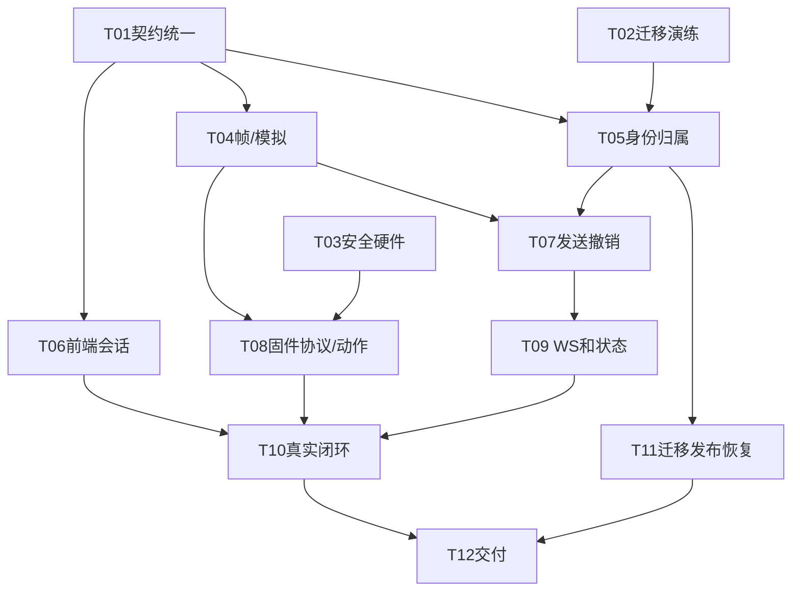

# Pet-Dog V3.0 需求追踪与验收表

> 日期：2026-11-10。配套[统一实施与交付计划](项目统一实施与交付计划_V3.0.md)。  
> 本表全部为待实施/待验收项，不能把方案描述或历史review当成测试通过。  
> 角色：BA后端A、BB后端B、FE前端、EA固件、EB硬件。C=本期核心，X=扩展准入，D=后续版本。  
> 验收记录字段：需求ID、负责人姓名、状态、commit/固件版本、环境、输入、期望、实际、证据路径、复核人、日期。

## 1. 原46项功能逐条映射

表中“验收证据”是将来应提交的产物，不是本次已取得结果。

| 原ID | 功能 | V3范围 | 负责人 | 验收证据/范围说明 |
|---|---|---|---|---|
| F-1-01 | 站立复位 | C | EA/EB | 行程校准、站立视频、负载电流，不能统一强迫所有舵机90° |
| F-1-02 | 前进 | C | EA/EB | 连续三步及连续三次不摔，记录地面/电压 |
| F-1-03 | 后退 | C | EA/EB | 反向步态及恢复站立视频 |
| F-1-04 | 左转右转 | C | EA/EB | 两向转动与稳定姿态，实测转角 |
| F-1-05 | 趴下蹲下 | C | EA/EB | 两姿态互切及起身，不堵转 |
| F-1-06 | 摇尾巴动作 | X | EA | 非必需，上电自检尾摆不等于该独立命令已实现 |
| F-1-07 | 前跳后跳 | D | EA/EB | 机械/峰值电流验证前不开放 |
| F-1-08 | 伸懒腰 | D | EA | 保留动作码，能力表禁用 |
| F-2-01 | 七表情位图 | C | EA | 七张128×32预设，板端截图 |
| F-2-02 | 动作表情联动 | C | EA/FE | 七基础动作映射、结束恢复默认 |
| F-2-03 | 呼吸灯 | X | EA | 先补LED ACK完成语义，运动不中断 |
| F-2-04 | 开机自检 | C | EA/EB | 安全摆放上电，3秒内显示，记录启动行为 |
| F-2-05 | 切换不闪屏 | C | EA | 连切20次，串口不因OLED刷新丢帧 |
| F-2-06 | 前端预设表情 | C（提升） | FE/BA/EA | 作为七表情演示入口；点击后看上报和实物，不伪造ACK |
| F-2-07 | 自定义表情上传 | D | FE/BB/EA | 512字节图片与31字节帧的分包/烧录方案另立任务 |
| F-3-01 | 屏幕分区 | X天气包 | EA | 核心固定128×32表情；下半天气区域扩展 |
| F-3-02 | 下发校时 | X天气包 | BA/EA | 0x08标准Unix秒，无重复加8小时 |
| F-3-03 | 屏幕走时 | X天气包 | EA | 同一小时对时记录，不能用模拟证明晶振精度 |
| F-3-04 | 天气抓取 | X天气包 | BB | 超时/无网缓存、标记更新时间 |
| F-3-05 | 天气下发 | X天气包 | BA/EA | 有符号负温度及码表向量 |
| F-3-06 | 图标温度 | X天气包 | EA | 每个合法天气码显示一致 |
| F-3-07 | 前端天气时钟 | X天气包 | FE | 显示数据源与过期时间，不伪称设备当前时间 |
| F-4-01 | 音响硬件 | X音乐包 | EB | 模块/供电/TF卡/扬声器测试 |
| F-4-02 | 播放音乐 | X音乐包 | EA/BA/FE | 声音、BUSY与0x0B对应，不以0x8A断言已播 |
| F-4-03 | 暂停继续 | X音乐包 | EA/BA/FE | 模块实测支持后才承诺断点续播 |
| F-4-04 | 上下一首 | X音乐包 | EA/FE | 五次切换曲目一致 |
| F-4-05 | 音量调节 | X音乐包 | EA/FE | 核对真实模块协议；0x0B不含音量 |
| F-4-06 | 播放状态回传 | X音乐包 | EA/BA | 状态变化主动上报，曲目值按真实可观测能力说明 |
| F-4-07 | TF曲目管理 | X音乐包 | EB | 文件命名/格式/曲目范围记录 |
| F-4-08 | 语音放歌 | D | EA | 语音和音乐双包通过后再做 |
| F-5-01 | 语音接线 | X语音包 | EB | USART1接线、电平及串口记录 |
| F-5-02 | 固定口令识别 | X语音包 | EA/EB | 预定词表、噪声条件与识别计数 |
| F-5-03 | 语音动作映射 | X语音包 | EA | 本地/远程仲裁，语音不能伪造远程seq |
| F-5-04 | 语音音乐 | D | EA | 依赖语音与音乐同时通过 |
| F-5-05 | 语音播报 | D | EA | 不阻塞主循环，明确本地播报来源 |
| F-5-06 | 语音蓝牙优先级 | X语音包前置 | EA/BA | 固件忙时拒绝新运动；扩展仲裁另定，不留“排队或丢弃”二选一 |
| F-6-01 | 登录鉴权 | C | BB/FE | tv/status复核、无默认账号、两账号隔离 |
| F-6-02 | 列表在线 | C | BB/BA/FE | owner过滤、有效上行刷新、9秒静默离线 |
| F-6-03 | 命令回执 | C | BA/EA/FE | 六态+cmd_id+revision，受理不等完成 |
| F-6-04 | 实时推送 | C | BA/FE | command/state/link，HTTP补偿恢复 |
| F-6-05 | 日志页面 | X日志包 | BB/FE | 核心已落库和单命令查询；分页页面扩展 |
| F-6-06 | 遥测曲线 | X日志包 | BB/FE | 核心已存遥测；曲线和日聚合扩展 |
| F-6-07 | 场景编排 | D | BA/FE | 每步授权，unknown终止，持久运行恢复另验 |
| F-6-08 | 一键启动 | C | BA/BB | 配置/迁移/初始化一次完成后，日常单命令启动 |
| F-6-09 | 多设备 | D | BA/EA | 无地址协议不允许一条串口多设备混用 |
| F-6-10 | 异常降级 | C | 全员 | 断链/断网/重启有明确恢复状态，禁止旧动作重放 |

核心共有16个原功能编号（原核心15项，加F-2-06演示入口）；七动作的实际实现数不等于功能项数。

## 2. v10新增需求覆盖

| 新ID | 需求 | 范围/任务 | 验收 |
|---|---|---|---|
| S01 | owner外键、be与历史隔离 | C，T02/T05 | 两账号交叉所有资源，历史与缓存不泄漏 |
| S02 | 单账号一设备、认领码单行 | C，T05 | 真实MySQL唯一约束和并发测试 |
| S03 | tv、改密、登出全部会话 | C，T05/T06/T07 | 旧HTTP/WS/未发命令全部失效，本人历史不丢 |
| S04 | 自助解绑、注销两阶段 | C，T05/T07 | revoking立即拒绝，清理重启可恢复 |
| S05 | CLI初始化/恢复管理员 | C，T05 | 两初始化只成功一次；唯一管理员忘密可恢复 |
| S06 | 无默认秘密及密码hash升级 | C，T05/T11 | 发布扫描、旧凭据失效、生产Mock关闭 |
| S07 | 设备交接/retire/reinstate | C最小CLI，T05/T07 | handover未通过不认领，无claim行恢复并发只成功一次 |
| S08 | 演示免码 | 不实现 | 所有演示按真实配对流程 |
| S09 | 管理员网页/角色升降级 | D | 未实现端点不存在，不只隐藏菜单 |
| S10 | 自定义表情签名URL | D随自定义表情 | 原签名方案不是首版必建系统 |
| S11 | 归档隔离与迁移恢复 | C，T02/T11 | 计数/hash、failpoint、恢复到隔离库 |
| S12 | sessionEpoch与跨标签页 | C，T06 | 旧响应/401/WS不会污染新账号 |
| S13 | dispatch_generation | 首版不加额外列 | 本版单在途、tv/be/session校验足够；新消费者出现再证明必要性 |
| S14 | 本机单实例及丢锁停发 | C，T07 | 第二实例拒绝，断DB锁连接旧实例关闭串口退出 |
| S15 | 限流、可信IP、setup提示 | C，T05/T06 | 代理头不能绕过，setup失败不锁登录 |
| S16 | 硬件UID/认证 | D | 明确登记映射不是加密认证，不以UID可见就证明持有者 |
| S17 | 数据导出/隐私说明 | D自助导出；C访问边界 | CLI归档导出有审计且不进普通接口 |
| S18 | 承诺提醒 | X独立扩展 | 定时重鉴权、取消/重启不重复补发；未开包不承诺 |

## 3. v10的31项测试去向

A=自动化，H=人工真实交互，D=延期；未运行统一标“待验收”。

| v10测试号 | 本版覆盖与修订 | 方式 / 负责人 |
|---:|---|---|
| 1 | A不可列出/查询B设备 | A+H，BB/FE |
| 2 | 越权修改不能生效 | A，BB |
| 3 | 两人同码只一成功 | A真实MySQL，BB |
| 4 | 第五次错码锁定，正确码也不得绕过 | A，BB |
| 5 | 消费后错码不再增加计数 | A，BB |
| 6 | 交接完成才重新认领；新主不可读旧历史 | A+HW，BA/BB |
| 7 | 改密tv变、be不变、旧token失效 | A+H，BB/FE |
| 8 | 注销竞争claim不产生失效owner | A，BB |
| 9 | 注销、tombstone、清理恢复与交接门禁 | A，BB/BA |
| 10 | disabled不能登录/调用资源 | A，BB |
| 11 | 同用户并发两设备只一成功 | A，BB |
| 12 | 同用户重复claim幂等 | A，BB |
| 13 | 重签后旧码失效 | A，BB |
| 14 | 最后admin保护，所有已开放路径统一锁 | A，BB；未开放升降级路径断言不存在 |
| 15 | 新写归属非空，最终DB直接拒绝NULL | A真实MySQL，BB |
| 16 | 归档普通用户/普通管理员API不可见 | A，BB |
| 17 | setup只读，无HTTP管理员初始化入口 | A路由表+黑盒，BB |
| 18 | CLI首建成功，再建拒绝 | A，BB |
| 19 | 双CLI并发首建仅一成功 | A同MySQL，BB |
| 20 | reset/enable增加tv并写审计 | A，BB |
| 21 | 诊断报告异常不阻塞恢复，约束拒坏行 | A旧fixture/新库分开，BB |
| 22 | seed与迁移不生成可用默认凭据 | A，BB |
| 23 | 密码终端回显/argv/管道拒绝 | A+Windows实机H，BB |
| 24 | 源码、Office XML、生产dist、运行OpenAPI秘密扫描 | A发布门禁，BA/BB；不把任意数字串当秘密 |
| 25 | 注册无设备；有效码独立授权可claim | A+H，BB/FE |
| 26 | setup网络失败不锁登录；无admin也不禁止已有普通用户登录 | A前端，FE |
| 27 | retired不认领；注销后handover required，不立即入池 | A，BB/BA |
| 28 | DDL/DML确定断点中断重跑 | A隔离库，BB |
| 29 | dump→restore→版本迁移→隔离查询 | A+H，BB |
| 30 | 清旧localStorage明文与旧token，按user.id分区 | A前端+H，FE |
| 31 | 无claim行设备retire后双reinstate只有一成功 | A，BB；须同时满足停机/交接门禁 |

## 4. 本轮新增的关键测试

| ID | 复现操作 | 通过判据 | 主责 |
|---|---|---|---|
| N01 | WS done先到，HTTP pending后到 | revision不回退，前端仍done | FE/BA |
| N02 | 不注入ACK，仅注入有效DONE | 对应在途命令done，不误判失败 | BA |
| N03 | write报告异常后有效DONE到 | 审计留异常、结果能依据证据修正；不重发 | BA |
| N04 | 撤销先获得SendGate，writer已出队 | 撤销提交后不发生该命令write | BA/BB |
| N05 | write先持锁，撤销随后到 | 不宣称收回旧动作；后续write全拒绝 | BA/BB |
| N06 | 注销提交后清理进程崩溃 | 重启继续清理，权限保持失效 | BB |
| N07 | DB锁连接单独断开而进程仍活 | 旧进程停止write/心跳、关串口退出 | BA |
| N08 | 解绑、再认领，注入旧ACK/旧0x03 | 不污染新epoch命令、快照和历史 | BA/BB |
| N09 | 会话第256次申请seq | 不复用旧序号，明确恢复要求 | BA |
| N10 | ACK/DONE在旧会话结束后迟到 | orphan/旧会话审计，不认领新命令 | BA |
| N11 | 一个WS堆满128个关键事件，再来遥测 | 不删关键事件；慢连接受控关闭，另一连接仍工作 | BA |
| N12 | 第一个HTTP落库后进程崩溃、未入队 | 重启unknown，无自动write | BA |
| N13 | 实际write成功但后续DB提交失败 | 不重发、停止新动作、可恢复诊断 | BA/BB |
| N14 | 同key并发20次、重复请求与busy重叠 | 一条记录/一帧，其余返回原单 | BA/BB |
| N15 | 0x03 LEN=5/6/7/9，各字段边界 | 不越界，不读半电压，不混协议版本 | BA/EA |
| N16 | 不同旧布局也长9字节 | 禁止按长度自动识别，配置版本不匹配拒绝控制 | BA/EA |
| N17 | 收到0x84再重复注入 | 不形成0x04/84回显循环 | BA/EA |
| N18 | 50个动作并发提交 | 一条在途，其余明确busy，绝不未来逐个跑 | BA/FE |
| N19 | 无admin但普通用户存在且密码正确 | 仍可登录；setup提示不代替授权 | BB/FE |
| N20 | 真实账号数≠2、含未知历史、重复msg_id | 迁移不写死行数、不强归属，保留归档证据 | BB |
| N21 | 改密时已有旧WS消息在队列 | 提交后的新发送检查拒绝旧版本；已进入网络的数据不承诺追回 | BA |
| N22 | 物理COM指向另一块板 | 人工登记核对未通过不得开放控制 | EB/BA |

这些测试都必须落到实际实现再运行，本次计划编写不声称它们已通过。

## 5. 任务依赖与门禁



| 门禁 | 日期 | 必须提供 | 未通过时 |
|---|---|---|---|
| G0 | 11/15 | 六份契约一致，角色名单，实物/接线状态，预算确认 | 先补接口/硬件，不各自发明协议 |
| G1 | 11/22 | SIM状态全流程、owner隔离、帧向量 | W4先修，不开扩展 |
| G2 | 11/29 | 真机动作、SendGate撤销、online/断链 | 明确真机延期；模拟不抵扣 |
| G3 | 12/06 | 七动作/七表情、核心账号设备功能 | 不开扩展，更新剩余工时 |
| G4 | 12/13 | 2小时长跑、200顺序命令、备份恢复 | PCB可回退，功能削减要用户批准 |
| G5 | 12/20 | 新人部署、完整日志、三次演练、无阻断缺陷 | W8只修失败项 |
| G6 | 12/27 | 发布包、源码tag、烧写与接线说明、证据目录 | 如实列出未交付，不改验收历史 |

## 6. 验收命令约定与证据模板

下列后端测试文件为计划中待新增文件，不代表仓库当前已有；测试数据库必须是隔离库，脚本应拒绝生产库名。

在backend目录：
```powershell
.venv/Scripts/python.exe -m pytest tests/test_frame.py tests/test_session.py tests/test_commands.py -q
.venv/Scripts/python.exe -m pytest tests/test_ownership.py tests/test_admin.py tests/test_send_revoke.py -q
.venv/Scripts/python.exe -m pytest tests/test_ws.py tests/test_migration.py -q
.venv/Scripts/python.exe -m alembic current
.venv/Scripts/python.exe -m app.cli check-consistency
```

在frontend目录：
```powershell
pnpm install --frozen-lockfile
pnpm test
pnpm build
```

版本以requirements和pnpm-lock实际可安装结果锁定；不为迎合旧文档版本号盲目升级。固件由原Keil工程构建，记录工程文件、编译器版本和完整build log，不在计划里虚构一个通用工程路径。

每条验收记录：
```text
ID:
负责人 / 复核人:
代码commit / 固件hash:
环境: SIM 或 HW；系统/数据库版本；设备/COM；供电
前置数据:
输入步骤:
期望结果:
实际结果:
证据: 测试报告/原始帧/视频/数据库规范化摘要的相对路径
状态: 未开始 / 开发中 / SIM通过 / HW通过 / 失败 / 延期
失败原因及下次验证:
日期:
```

示例可公开去标识化账号/设备编号，不能上传真实密码、配对码、JWT、DB连接串或含个人数据的数据库备份。

## 7. 本版仍需真实证据关闭的事项

| 未知项 | 最小实验/产物 | 截止门禁 | 默认行为 |
|---|---|---|---|
| 开发板和模块到货 | EB清单、照片、购买或借用日期 | G0 | 不承诺HW通过 |
| 蓝牙SPP/串口与旧缓冲行为 | 真模块往返、断电后注入旧帧实验 | G2 | USB-TTL开发，无法净化则不自动复用seq |
| 七动作最坏时长/行程 | 两档供电各20次测量表 | G3 | 未测动作正式能力禁用 |
| 实际schema与用户历史 | BB只读清点报告和恢复副本 | T02前 | 不轮换/删除未知真实用户 |
| 前端依赖和构建 | 新环境锁文件安装与build | G1 | 不把已有UI截图当可部署证明 |
| 单实例丢锁停发 | N07故障注入 | G2 | 不提供多worker/多主部署 |
| 归属交接清理可靠性 | N08/N10硬件测试 | G2 | handover保持required，拒绝新认领 |
| 是否开启扩展 | G3真实完成度和角色余量 | 12/06 | 不启用任何扩展 |

