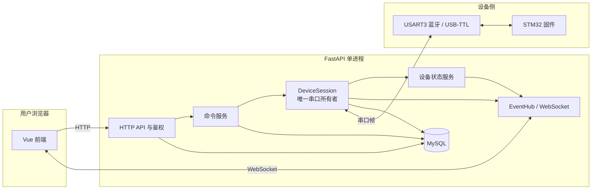
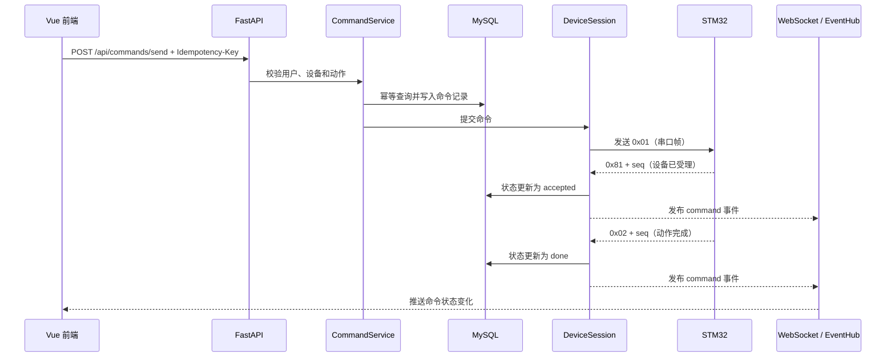
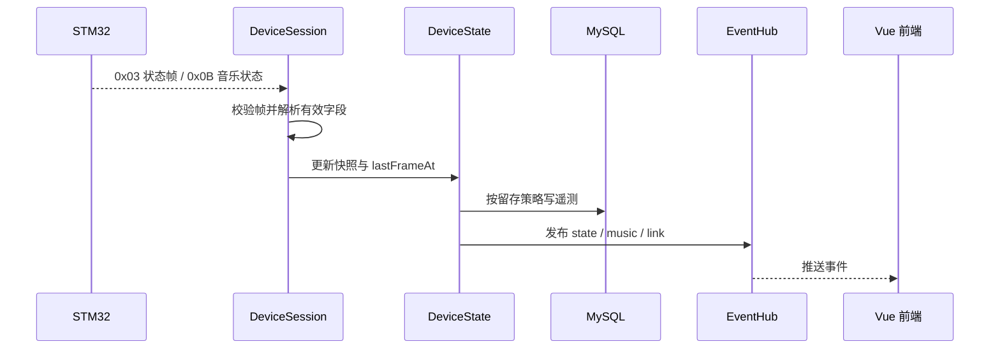

# Pet-Dog 项目目标架构与团队分工

> 版本：1.0（小组评审稿）  
> 用途：统一后端、前端与 STM32 固件的模块边界、数据流和分工，供开发联调与项目汇报使用。  
> 本文是架构总览；具体字段、命令码、事件格式和数值以 [`docs/contracts/`](contracts/) 中的契约文件为准。本文与契约冲突时，以契约为准，并同步修订本文。

## 1. 项目目标

Pet-Dog 由 Vue 网页控制台、Python/FastAPI 后端和 STM32 固件组成。网页负责用户交互，后端负责鉴权、命令管理、状态汇总和消息推送，固件负责硬件控制和设备侧状态上报。

系统采用一条明确的设备通信路径：**所有设备串口读写由后端的 `DeviceSession` 独占；应用服务不直接访问串口；固件是通过串口连接的外部系统。**这样，命令只有一个出口，设备状态也有明确的更新来源。

## 2. 当前代码基线

以下是整理本文时检查到的仓库状态，便于组员区分“已有实现”和“目标设计”：

| 部分 | 当前基线 | 目标方向 |
|---|---|---|
| 后端 | 已有 FastAPI 应用、认证路由、SQLAlchemy 模型；命令路由、串口会话和 WebSocket 服务尚未形成完整实现 | 在应用生命周期中创建 `DeviceSession`，按契约补齐命令、设备状态和事件服务 |
| 前端 | 已有 Vue 页面、API 模块、Pinia store 和 WebSocket 客户端；部分行为仍与契约不一致 | 依 OpenAPI 与事件契约对齐命令主键、超时归属、WS ticket 和重连对账 |
| 固件 | 固件实现与硬件联调尚未形成可验收的完整链路 | 按帧契约实现 USART3 通信、命令分派、状态上报和回执 |
| 契约 | `docs/contracts/` 已有帧、动作时序、HTTP、WS 和错误码契约 | 契约作为三端协作依据，修改时同步更新实现和测试 |

后端启动入口目前使用 `reload=True`，数据库表由应用导入时创建。目标实现需把设备会话和后台任务放进 FastAPI lifespan，并将数据库结构变更纳入 Alembic 迁移；开发重载期间不得产生多个串口所有者。

## 3. 总体架构

### 3.1 设备物理链路

- 开发阶段没有真机时，使用后端进程内模拟器。模拟器注入符合帧契约的回执和状态帧，经由与真实设备相同的解析入口处理；模拟器测试不等于真实串口或蓝牙验证。
- 真机通信使用板上 USART3 蓝牙 UART。开发期如用 USB-TTL，接 USART3 UART 引脚并断开蓝牙模块；USART1 已被语音模块占用，USART2 引脚被舵机定时器占用。
- 后端串口参数、帧长、校验和、20 ms 帧间隔及命令字段见 [`frame.md`](contracts/frame.md)。
- 串口写入成功只表示本机驱动接受字节，不表示蓝牙对端或 STM32 已收到。只有匹配的设备回执能推进有生命周期命令的状态。

### 3.2 后端内部边界

| 模块 | 职责 | 关键约束 |
|---|---|---|
| `routers/` | 接收 HTTP/WS 请求、调用应用服务、返回契约定义的结构 | 路由不直接操作串口，不承载设备状态机 |
| `services/command_service.py` | 命令校验、幂等检查、落库、提交发送、查询命令 | 幂等检查先于 seq 分配；重试不得重复下发 |
| `services/device_session.py` | 串口唯一所有者；读写队列、帧解析、seq、pending、回执超时、心跳发送 | 在 FastAPI lifespan 创建；进程中只能有一个活动会话 |
| `services/device_state.py` | 设备快照、`lastFrameAt`、`online` 判定 | 设备 `online` 只能由该模块更新 |
| `services/event_hub.py` | 进程内事件发布订阅、每连接独立发送队列 | WS 慢客户端不能阻塞串口读取 |
| `link/` | 串口适配与帧读写接口 | 模拟器与真串口适配器实现同一接口 |
| `models.py` / 数据访问层 | 用户、设备、命令、遥测、场景等持久化模型 | 数据库状态语义与契约枚举一致 |

`DeviceSession` 的创建和关闭由 FastAPI lifespan 统一管理。启动时先恢复未终结命令，再打开链路并启动读循环、写循环、心跳任务和超时管理；关闭时停止接收新命令、取消后台任务并关闭串口。串口句柄不得在模块 import 时创建。

## 4. 核心数据流

### 4.1 动作命令：网页到设备再回到网页

命令规则：

1. 前端为每次用户意图生成 UUID，放入 `Idempotency-Key`；返回的 `cmdId` 是前端识别这条命令的主键。seq 是串口内部短序号，只用于设备回执匹配和排查，前端不得用它作为命令 ID。
2. 后端按 `(device_id, msg_id)` 检查幂等记录。键和请求内容都相同则返回原记录、不分配新 seq、不重发；键相同但请求内容不同则按 OpenAPI 契约返回业务错误。
3. 命令写库后进入写队列。完整写入后状态仍为 `pending`；收到 `0x81` 才是 `accepted`，收到 `0x02` 才是 `done`，收到 `0x05` 才是 `rejected`。
4. `T_ack=600 ms`；动作受理后按 `T_done = max_duration_ms + 600 ms` 等待完成。超时状态是 `unknown`，不能推断设备一定没有执行。动作时序与未测量动作的安全上限见 [`action-timing.md`](contracts/action-timing.md)。
5. 只有新运动命令被设备受理后，才把仍在执行且被打断的旧动作标为 `superseded`。LED 命令不应打断舵机动作。
6. 进程启动时，旧的 `pending/accepted` 命令恢复为 `unknown`，不自动重发；自动重发动作可能导致设备重复运动。

HTTP 使用仓库统一返回体 `{code, message, data, timestamp}`。HTTP 成功落库不代表设备收到；最终命令结果通过 `GET /api/commands/{cmdId}` 或 WS `command` 事件查询。详见 [`openapi.yaml`](contracts/openapi.yaml)。

### 4.2 遥测：设备到网页

- `0x03` 更新设备状态快照；短帧按已收到的前缀解析，缺少字段显示为未知，不用 0 伪装有效值。字段布局目前是待固件确认的提案，见 [`frame.md`](contracts/frame.md) §7。
- `0x0B` 更新音乐状态并产生 `music` 事件。它是设备状态上报，不是播放命令的回执；上报周期或触发时机仍待固件确认。
- 只有有效上行帧刷新后端的 `lastFrameAt`。连续 9 秒无有效上行帧后判 `offline`；串口是否打开和心跳是否发送是独立状态。
- 后端每 3 秒发 `0x04`；固件 9 秒收不到后端心跳时停止新的运动步骤并保持当前姿态。这是固件安全行为，不等同于后端 online 判定。
- 遥测存储目标：原始遥测保留最近 7 天，按日聚合保留 365 天；具体清理任务和索引在后端实现中负责。

## 5. WebSocket、鉴权与恢复

- HTTP API 使用 Bearer Token。浏览器 WebSocket 不能设置自定义 Authorization 头，因此先调用 `POST /api/events/ticket` 换取绑定用户和设备、30 秒有效、一次性的 ticket，再连接 `/ws/device?deviceId=...&ticket=...`。
- 建连后服务端先发送 `snapshot` 作为状态基线，再发送实时事件。事件名和结构以 [`events.md`](contracts/events.md) 为准：`snapshot`、`command`、`state`、`link`、`music`、`weather`、`scene`、`ping`。
- 每个连接使用容量为 128 的独立队列。`state/music/weather/ping` 可合并或丢弃旧值；`command/link/scene` 不得静默丢失，队列无法接收时关闭慢连接。
- 前端重连后以 `snapshot` 覆盖本地设备状态，并通过 `/api/commands/active` 和 `/api/commands/{cmdId}` 对账未完成命令。事件是增量通知，数据库和快照是恢复依据。
- 后端命令状态与串口传输状态分开：命令状态为 `pending/accepted/done/rejected/unknown/superseded`；传输状态为 `ok/write_failed/partial_write`。`partial_write` 必须对应 `unknown`。状态编号和迁移规则见 [`frame.md`](contracts/frame.md) 与 [`error-codes.md`](contracts/error-codes.md)。

## 6. 设备协议边界

| 设备命令 | 架构中的处理方式 |
|---|---|
| `0x01` 动作 | 唯一具备完整命令生命周期的设备命令；用 seq 匹配 `0x81/0x02/0x05` |
| `0x06` 查询状态 | 即发即忘触发器；后续 `0x03` 没有关联号，不当作该次查询的确认 |
| `0x07` 表情 | 即发即忘，不建命令生命周期记录；只能靠之后的状态变化更新 UI |
| `0x08~0x0A` 校时、天气、音乐控制 | 无 seq；`0x88/0x89/0x8A` 只能记录为弱确认，不能置 `accepted/done` |
| `0x0B` 音乐状态 | 固件上报事件，更新音乐快照；没有命令回执含义 |
| `0x44~0x47` LED 动作码 | 仍走 `0x01` 与 seq；固件分支不得改写 `run_flag/cur_action`，不等待 `0x02`，收到 `0x81` 即按动作时序契约完成 |

帧最大总长为 36 字节（`LEN≤31`，LEN 只计 DATA）；同一发送端帧间隔至少 20 ms。`0x03` 九字节布局、`0x04/0x84` 的准确交互、`0x0B` 上报时机及 seq 迟到帧最大延迟均需在固件联调中确认。不得把未确认项在汇报或演示中描述成已经实测。

## 7. 数据与可靠性

| 数据 | 保存方式 | 说明 |
|---|---|---|
| 用户、设备、场景、表情资源 | MySQL 业务表 | 由后端模型和迁移管理 |
| 命令记录 | MySQL `command_log` | 记录 `cmdId/msg_id`、seq、状态、传输结果、时间；`(device_id,msg_id)` 唯一 |
| 当前设备快照 | 后端状态服务内存缓存，可配合 DB 最近值 | WS 建连时用于 `snapshot`；由有效设备上报更新 |
| 原始遥测 | MySQL，按设备和时间索引 | 保留最近 7 天并定期清理 |
| 日聚合遥测 | MySQL 聚合表 | 保留 365 天，支持趋势页面和历史查询 |
| 无法匹配的回执帧 | 结构化日志或 orphan 帧表 | 保留原始帧、设备、帧码、seq、时间和解析原因，不能静默丢弃 |

数据库结构使用 Alembic 管理。命令状态枚举、传输枚举和唯一索引由迁移显式建立；旧 `status=1` 不猜含义，迁移为 `legacy_unmapped`，历史重复幂等键先归档再加唯一约束。

## 8. 小组分工与交付物

| 角色 | 负责范围 | 需要提交的内容 | 验收方式 |
|---|---|---|---|
| 后端 | FastAPI 生命周期、串口适配、DeviceSession、命令服务、数据库迁移、EventHub、WS ticket | 后端模块实现、迁移脚本、自动化测试、日志字段 | 模拟器完成动作命令全流程；测试 ACK 超时、完成超时、重启恢复、重复请求；串口读循环不被慢 WS 客户端阻塞 |
| 固件 | USART3 收发、帧解析/校验、动作码分派、ACK/完成帧、LED 分支、心跳看门狗、状态/音乐上报 | 固件实现、固定帧向量测试、动作时序测量表 | 回执 seq 正确；LED 不打断动作；心跳超时停止新动作并保持姿态；状态帧字段与契约一致 |
| 前端 | 命令 API、`cmdId` 状态管理、一次性 WS ticket、事件处理、快照和重连对账 | API/类型更新、界面状态、前端测试 | 无本地命令超时裁决；WS 断线后能恢复快照和命令状态；弱确认不显示为动作完成 |
| 全员/集成负责人 | 协议冻结、接口评审、跨端联调和演示验收 | 契约评审记录、端到端验收记录、问题清单 | 模拟器与真机结果分开记录；所有待确认项明确责任人和证据 |

### 开发顺序

1. 全员先确认 `docs/contracts/`，优先核实 `0x03` 布局、`0x04/0x84` 交互、`0x0B` 触发方式和动作时长测量规则。
2. 后端实现帧编解码、单一 `DeviceSession` 和进程内模拟器，完成一条 `0x01 → 0x81 → 0x02` 垂直切片。
3. 固件按同一组帧向量实现 USART3 链路和回执；前端并行按 OpenAPI/WS 契约改命令主键、状态处理和重连流程。
4. 三端通过模拟器和固定测试向量后再接 USB-TTL/蓝牙真机，测 ACK 延迟、动作时长、断链行为和遥测字段。
5. 验收完成后更新契约版本、测试结果和演示说明，再合并到集成分支。

## 9. 汇报时的说明口径

本项目采用前端、后端、固件三端分层协作。前端负责交互，后端是设备通信和命令状态的唯一管理者，STM32 固件执行硬件动作并上报事实。命令通过 HTTP 下发、通过 WebSocket 实时反馈，命令日志负责断线后的结果对账。当前最重要的工程控制点是统一串口所有权、区分“写入成功”和“设备完成”、以及让三端共享同一份协议契约。模拟器阶段验证软件链路，只有真机测试才能证明蓝牙和固件行为。

## 10. 相关契约

- [串口帧契约](contracts/frame.md)
- [动作时序与全局常量契约](contracts/action-timing.md)
- [HTTP API 契约](contracts/openapi.yaml)
- [WebSocket 事件契约](contracts/events.md)
- [错误码契约](contracts/error-codes.md)
